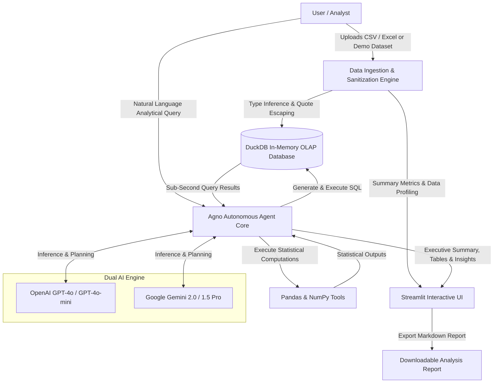

<div align="center">

# 📊 Autonomous AI Data Analysis Agent
### Natural Language In-Memory OLAP Query Engine powered by Agno, DuckDB & LLMs

[](https://www.python.org/)
[](https://streamlit.io/)
[](https://agno.com)
[](https://duckdb.org/)
[](https://openai.com/)
[](https://deepmind.google/technologies/gemini/)
[](LICENSE)

An enterprise-grade, conversational **AI Data Analyst Agent** that translates natural language queries into executable **DuckDB SQL** and **Pandas analytics**. Upload any CSV or Excel dataset to perform exploratory data analysis, compute KPIs, uncover trends, and export executive reports—with zero manual SQL writing required.

</div>

---

## 📌 Table of Contents
- [Key Highlights](#-key-highlights)
- [System Architecture](#-system-architecture)
- [Core Features](#-core-features)
- [Project Structure](#-project-structure)
- [Getting Started](#-getting-started)
  - [Prerequisites](#prerequisites)
  - [Installation](#installation)
  - [Environment Configuration](#environment-configuration)
  - [Running the Application](#running-the-application)
- [Supported LLM Backends](#-supported-llm-backends)
- [Sample Queries & Use Cases](#-sample-queries--use-cases)
- [Resume & Portfolio Highlights](#-resume--portfolio-highlights)
- [License & Author](#-license--author)

---

## 🌟 Key Highlights

- **Zero-Setup OLAP**: Leverages **DuckDB** directly in-memory to execute complex aggregations, joins, and filtering on hundreds of thousands of rows with sub-second latency.
- **Multi-Provider LLM Intelligence**: Switch dynamically between **OpenAI (GPT-4o, GPT-4o-mini)** and **Google Gemini (2.0 Flash, 1.5 Pro)**.
- **Privacy-First Architecture**: Your underlying raw data records **stay local in memory**; only table schemas, metadata, and generated queries are communicated to the LLM.
- **One-Click Demo Mode**: Ships with a realistic `sales_performance_data.csv` dataset, enabling instant interactive demonstrations without requiring file uploads.
- **Automated Data Sanitization**: Auto-infers datatypes, normalizes column names, sanitizes text strings, and builds clean relational tables on-the-fly.

---

## 🏗️ System Architecture



---

## ⚡ Core Features

| Feature | Description |
| :--- | :--- |
| **Natural Language to SQL** | Translates complex business questions into ANSI SQL queries optimized specifically for DuckDB. |
| **Instant Data Profiling** | Computes KPI summary cards: row counts, column counts, missing value percentages, and memory footprint. |
| **Interactive Data Exploration** | Multi-tab UI featuring raw data preview (up to 100 rows), full descriptive statistics (`df.describe()`), and schema inspections. |
| **Dual Agent Modes** | Available as a unified multi-provider app (`app.py`), or standalone dedicated scripts (`ai_data_analyst.py` and `analyst_using_gemini.py`). |
| **Session History** | Retains a searchable query history log across the session so you can track findings sequentially. |
| **Exportable Reports** | Export complete analyses, queries, and findings into markdown documents with a single click. |

---

## 📂 Project Structure

```bash
ai_data_analysis_agent/
├── .env.example                     # Sample configuration for OpenAI & Gemini API keys
├── .gitignore                       # Clean Git ignore rules (virtualenvs, secrets, cache)
├── LICENSE                          # MIT open-source license
├── README.md                        # Professional project documentation
├── requirements.txt                 # Pinned and documented dependencies
├── app.py                           # 🚀 Primary Unified Streamlit App (OpenAI + Gemini)
├── ai_data_analyst.py               # Standalone OpenAI Streamlit Analyst
├── analyst_using_gemini.py          # Standalone Google Gemini Streamlit Analyst
├── analysist_using_gemini.py        # Backward-compatible wrapper
├── command_to_run.txt               # Quick execution cheat-sheet
├── sample_data/
│   └── sales_performance_data.csv   # Comprehensive sample analytical dataset
└── utils/
    ├── __init__.py                  # Utility package exports
    └── data_processor.py            # Sanitization, type coercion & DuckDB table loader
```

---

## 🚀 Getting Started

### Prerequisites
- **Python 3.10+** (Tested on Python 3.11)
- An active API key from [OpenAI](https://platform.openai.com/) or [Google AI Studio](https://aistudio.google.com/)

### Installation

1. **Clone the repository:**
   ```bash
   git clone https://github.com/Vaibhav1376/ai-data-analysis-agent.git
   cd ai-data-analysis-agent
   ```

2. **Create and activate a virtual environment:**
   ```bash
   # Windows (PowerShell)
   python -m venv .venv
   .venv\Scripts\Activate.ps1

   # macOS / Linux
   python3 -m venv .venv
   source .venv/bin/activate
   ```

3. **Install dependencies:**
   ```bash
   pip install -r requirements.txt
   ```

### Environment Configuration

Create a `.env` file in the root directory (or use `.env.example` as a template):

```bash
cp .env.example .env
```

Add your keys:
```env
OPENAI_API_KEY=sk-...
GEMINI_API_KEY=AIzaSy...
```
*(Note: You can also enter API keys directly into the Streamlit sidebar during runtime.)*

### Running the Application

Launch the **Unified Multi-Provider App**:
```bash
streamlit run app.py
```

Or run either standalone version:
```bash
# OpenAI GPT-4o Edition
streamlit run ai_data_analyst.py

# Google Gemini Edition
streamlit run analyst_using_gemini.py
```

---

## 🤖 Supported LLM Backends

| Provider | Models Supported | Best For |
| :--- | :--- | :--- |
| **OpenAI** | `gpt-4o`, `gpt-4o-mini`, `gpt-4-turbo` | Complex multi-stage queries, nuanced mathematical reasoning. |
| **Google Gemini** | `gemini-2.0-flash`, `gemini-1.5-pro`, `gemini-1.5-flash` | Ultra-fast execution, large context window queries, cost efficiency. |

---

## 💡 Sample Queries & Use Cases

When running the application with the included `sales_performance_data.csv`, try asking:

1. **Revenue Breakdown**:
   > *"What is the total revenue by product category, and which one has the highest average order value?"*
2. **Regional Analysis**:
   > *"Compare total revenue, total quantity sold, and average satisfaction score across North America, Europe, and Asia-Pacific."*
3. **Customer Segmentation**:
   > *"Which customer segment (Enterprise, SMB, Consumer) drives the highest volume, and what is their preferred payment method?"*
4. **Outlier Detection**:
   > *"Identify any transactions where discount percentage was above 10% and summarize the revenue impact."*

---

## 💼 Resume & Portfolio Highlights

If you are featuring this project on your resume, LinkedIn, or portfolio, here are tailored, impactful bullet points:

- **Autonomous Agent Architecture**: Engineered an autonomous data analytics agent using **Agno (Phidata)** and **DuckDB**, translating ambiguous natural language prompts into optimized SQL queries with sub-second execution.
- **Multi-LLM Integration**: Architected a provider-agnostic system supporting **OpenAI GPT-4o** and **Google Gemini 2.0**, featuring automated schema introspection and robust error-recovery mechanisms.
- **In-Memory Analytical Engine**: Integrated **DuckDB OLAP** to ingest and process heterogeneous CSV and Excel datasets locally, preserving data privacy while eliminating relational database overhead.
- **Production-Ready Web Application**: Developed an interactive **Streamlit** dashboard with real-time KPI metrics, descriptive statistics generation, conversation history logging, and one-click report exports.

---

## 📄 License & Author

Distributed under the **MIT License**. See [`LICENSE`](LICENSE) for details.

Developed with ❤️ by **[Vaibhav Kakad](https://github.com/Vaibhav1376)**  
- Email: [vaibhavkakad76@gmail.com](mailto:vaibhavkakad76@gmail.com)  
- GitHub: [@Vaibhav1376](https://github.com/Vaibhav1376)
